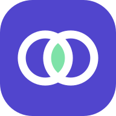
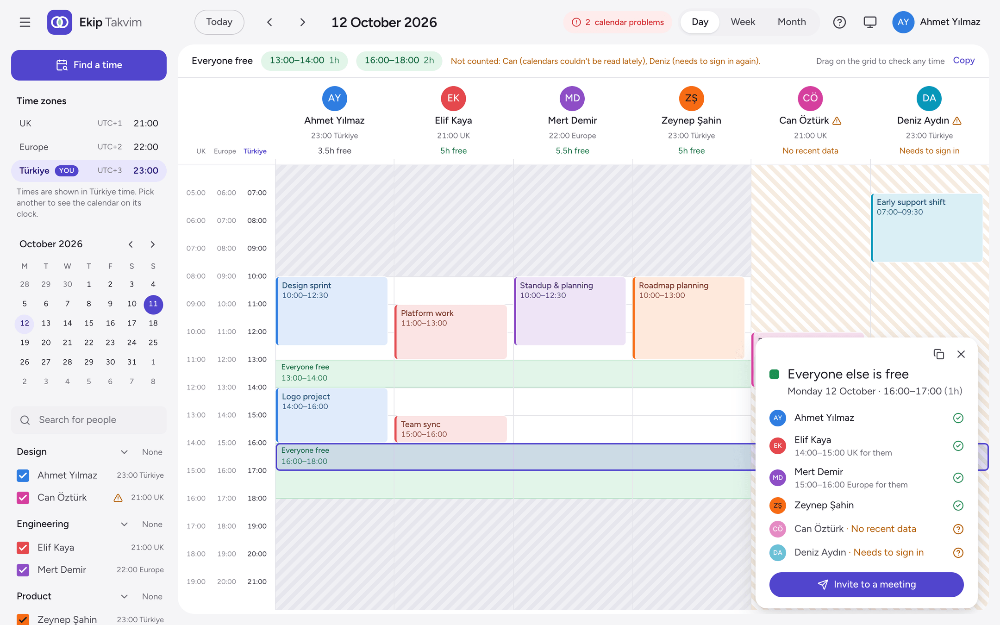
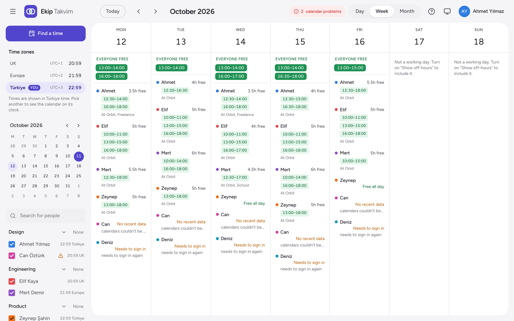
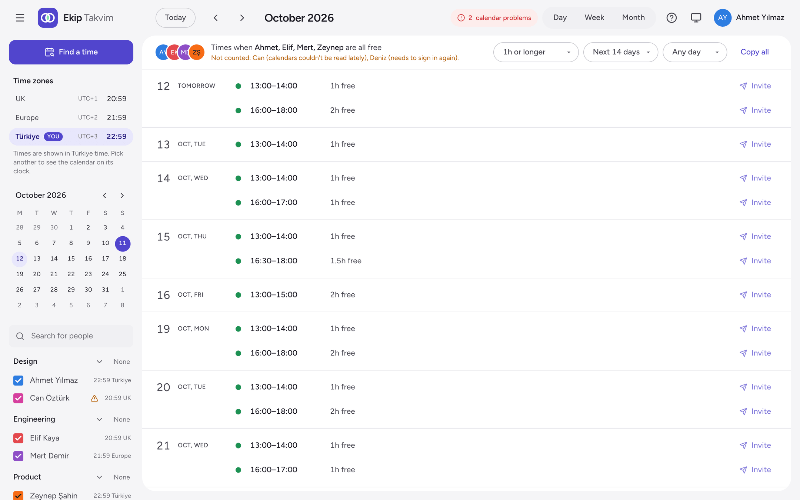
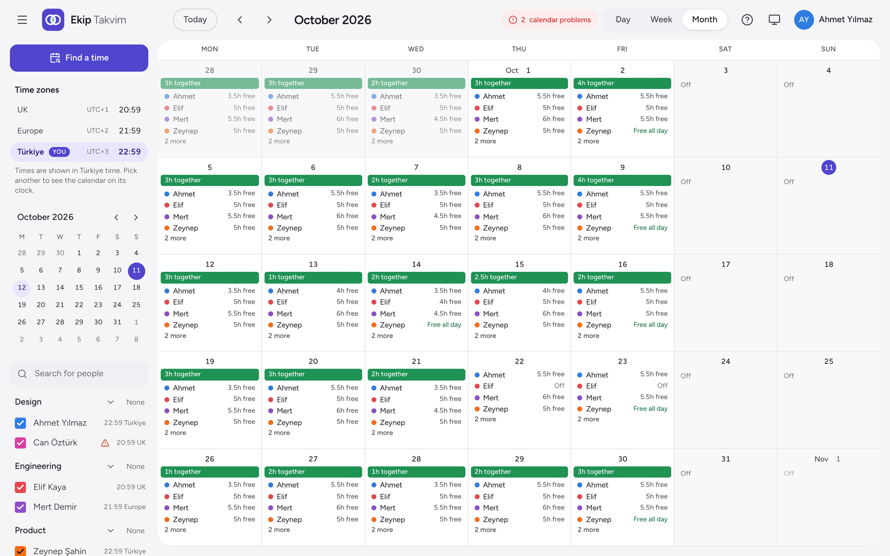
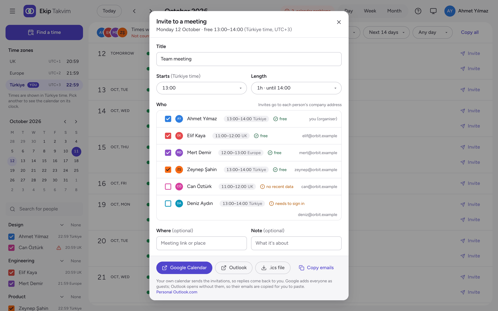

<p align="center">
  
</p>

<h1 align="center">Ekip Takvim</h1>

<p align="center">
  <strong>Who's free when, across everyone's calendars.</strong><br>
  A self-hosted team availability calendar for teams on Google Calendar, including people who also work elsewhere.
</p>

<p align="center">
  <a href="https://github.com/m3t3hn/ekip-takvim/actions/workflows/ci.yml"></a>
  <a href="https://github.com/m3t3hn/ekip-takvim/releases"></a>
  <a href="LICENSE"></a>
</p>

<picture>
  <source media="(prefers-color-scheme: dark)" srcset="docs/screenshots/day-dark.png">
  
</picture>

Many of us work more than one job, so "is Mert free on Thursday evening?" usually means asking around. With Ekip Takvim, everyone signs in once with their company Google account and shares their other calendars with it. From then on, the app answers that question for the whole team. *Ekip takvim* means "team calendar" in Turkish.

> [!IMPORTANT]
> Anyone who can open the app sees everyone's busy times, without signing in. Run it behind a VPN, an access proxy such as Cloudflare Access, or the built-in basic auth. See [access control](docs/access-control.md).

## Features

- **Day, week and month views** of everyone's free time, with green where everyone is free.
- **Find a time:** every gap that suits the whole team for as long as you need, plus slots that suit all but one person.
- **Other jobs count too:** people share their other calendars with their company account and pick which ones count as busy time.
- **Time zones done properly:** you see every time on your own clock, alongside each person's local time and fixed company working hours.
- **Invites in one click:** a prefilled event in Google Calendar or Outlook, or an `.ics` file.
- **Privacy built in:** colleagues see the titles of company-calendar events only, and personal calendars just show their label ([who sees what](docs/privacy-and-security.md#who-sees-what)).
- **Honest about gaps:** someone whose calendar can't be read isn't shown as free.
- **Easy to run:** read-only access to Google, one container with SQLite, and a config file you can do without.

| Week | Find a time |
|---|---|
|  |  |
| **Month** | **Invite** |
|  |  |

## Try the demo

Six made-up people with two jobs each, no Google account needed:

```bash
git clone https://github.com/m3t3hn/ekip-takvim.git && cd ekip-takvim
docker compose -f compose.demo.yaml up --build
```

Then open http://localhost:3000. With Node.js 22.13 or newer, `npm ci && npm run demo` works too.

## Install

You need Docker, a [Google OAuth client](docs/google-setup.md), and an HTTPS address behind your [access layer](docs/access-control.md).

```bash
git clone --branch v1.0.0 https://github.com/m3t3hn/ekip-takvim.git && cd ekip-takvim
cp .env.example .env    # set GOOGLE_CLIENT_ID, GOOGLE_CLIENT_SECRET, SESSION_SECRET and APP_URL
docker compose up -d --build
```

[The install guide](docs/install.md) walks through every step, including the optional `config/app.yaml` for working hours, teams and time zones.

## Documentation

- [Install](docs/install.md)
- [Google setup](docs/google-setup.md)
- [Access control](docs/access-control.md)
- [Configuration](docs/configuration.md)
- [User guide](docs/user-guide.md)
- [Privacy and security](docs/privacy-and-security.md)
- [Backup and restore](docs/backup-and-restore.md)
- [Upgrading](docs/upgrading.md)
- [Troubleshooting](docs/troubleshooting.md)
- [Development](docs/development.md)

## Contributing

Bug reports, fixes and ideas are welcome: see [CONTRIBUTING.md](CONTRIBUTING.md). Report security problems privately, as [SECURITY.md](SECURITY.md) describes.

## License

[MIT](LICENSE)
