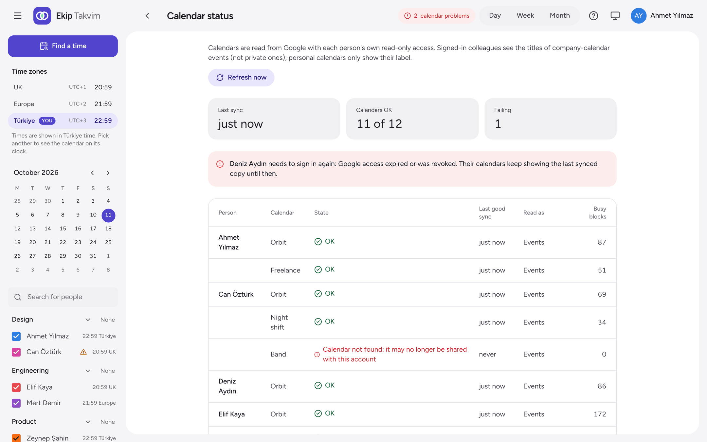

# Troubleshooting

Start with the logs:

```bash
docker compose logs -f ekip-takvim
```

Logs are JSON lines. The `starting` line shows:
- the version,
- where the config came from,
- whether sign-in is set up,
- which access checks are on.

The **Status** page in the app shows each calendar's sync state and errors.



## Signing in

**Google says `redirect_uri_mismatch`.**
The OAuth client's redirect URI must be exactly `APP_URL` followed by `/auth/google/callback`: same `https`, host and port, and no trailing slash. Fix whichever side is wrong. After changing `.env`, run `docker compose up -d`.

**Google says the app can only be used within its organisation (`org_internal`).**
The client is *Internal*, and the account isn't in your Google Workspace. Sign in with your company account.

**"Only company Google accounts can sign in."**
`google_domain` is set, and the account isn't on that domain. Personal Gmail accounts can never pass this check.

**"That sign-in took too long or came from another tab."**
The sign-in has to end in the same browser, at the same address, where it started. This usually means people open the app at one address (an IP, or another hostname) while `APP_URL` says another. Open it at the `APP_URL` address.

**"Google sign-in isn't set up on this server."**
One of `GOOGLE_CLIENT_ID`, `GOOGLE_CLIENT_SECRET` or `SESSION_SECRET` is missing, or `SESSION_SECRET` is shorter than 32 characters. The `starting` log line says *not set up*.

**"Google sign-in didn't work."**
The log has a `sign-in failed` line with Google's reason. It's usually a wrong client secret.

**Signing in works, but you're signed out again straight away.**
The browser isn't keeping the session cookie. The cookie is https-only unless `APP_URL` starts with `http://`, so open the app over HTTPS at the `APP_URL` address. For a quick test on your own machine, `APP_URL=http://localhost:3000` works.

## Calendars

**A calendar is missing from My settings.**
Share it with your company account, and accept it there: press **Add this calendar** in the email Google sends ([how](user-guide.md#adding-yourself)). Then press **Refresh from Google** on *My settings*.

**Someone shows "Needs to sign in".**
Their Google access ended: they removed the app in their Google account, their password or account changed, or the OAuth client is *External* and still in testing, where access lasts 7 days. They sign in again.

**Someone shows "No recent data", or a calendar fails on the Status page.**
The Status page shows Google's reason. Usually the calendar is no longer shared with their company account. Until it's read again, it keeps its last good copy.

**Times look off by a few hours.**
Check the team's `timezone` (or `TZ`) and each person's zone on *My settings*. Viewers always see their browser's zone, unless they picked another clock in the sidebar.

## The server

**`/healthz` says `"status":"degraded"`.**
The config file has a mistake. The app and the Status page say what it is. Fix the file and save; no restart needed.

**Every request answers `500 Set both …`.**
Only one of a pair is set: `CF_ACCESS_TEAM_DOMAIN` with `CF_ACCESS_AUD`, or `BASIC_AUTH_USER` with `BASIC_AUTH_PASSWORD`. Set both, or remove both.

**Every request answers `403 Open this app through Cloudflare Access`.**
Either the request didn't come through Access, or the token is for another application. Look for `Cloudflare Access token rejected` in the log:
- `ERR_JWT_CLAIM_VALIDATION_FAILED` usually means a wrong `CF_ACCESS_AUD` or team domain;
- `ERR_JWKS_TIMEOUT` or `fetch failed` means the server can't reach your team's `cloudflareaccess.com` address.

**The container can't write its database.**
You switched to a folder instead of the volume, and the folder isn't owned by the container's user. Fix it with `sudo chown 1000:1000 data`.

**The log says `DEMO_MODE ignored`.**
`DEMO_MODE=true` is set next to real Google settings. Remove it from `.env`.

Still stuck? [Open an issue](https://github.com/m3t3hn/ekip-takvim/issues/new/choose) with the version, your setup and the relevant log lines. Leave out secrets.
