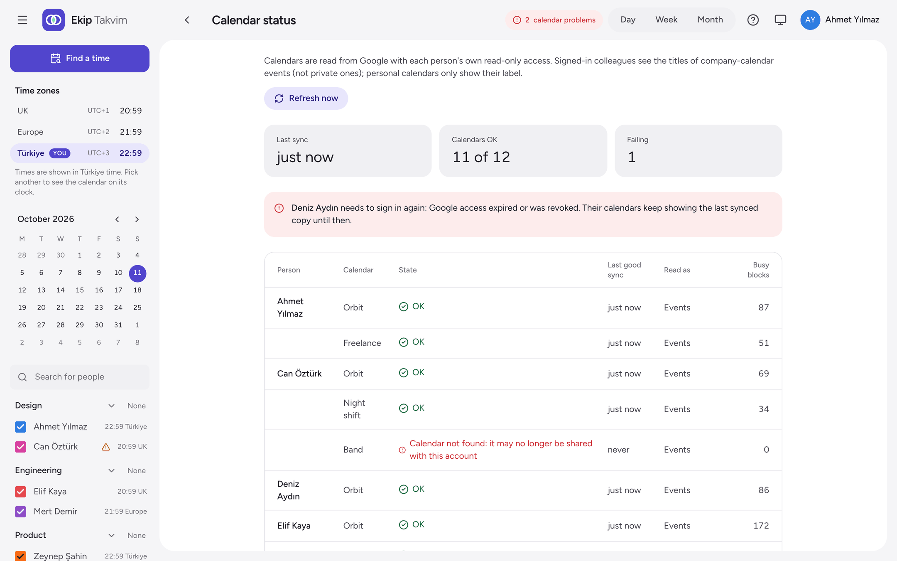

# Troubleshooting

Start with the logs:

```bash
docker compose logs -f ekip-takvim
```

Logs are JSON lines. The `starting` line shows:
- the version,
- where the config came from,
- whether sign-in is set up,
- which access checks are on, and where calendar links may go (`CALENDAR_LINKS`).

The **Status** page in the app shows each calendar's sync state and errors.



## Signing in

**Google says `redirect_uri_mismatch`.**
The OAuth client's redirect URI must be exactly `APP_URL` followed by `/auth/google/callback`: same `https`, host and port, and no trailing slash. Fix whichever side is wrong. After changing `.env`, run `docker compose up -d`.

**Google says the app can only be used within its organisation (`org_internal`).**
The client is *Internal*, and the account isn't in your Google Workspace. Sign in with your company account.

**"Only company Google accounts can sign in."**
`google_domain` is set, and the account isn't on that domain. Personal Gmail accounts can never pass this check.

**"That sign-in took too long or came from another tab."**
The sign-in has to end in the same browser, at the same address, where it started. This usually means people open the app at one address (an IP, or another hostname) while `APP_URL` says another. Open it at the `APP_URL` address.

**"Google sign-in isn't set up on this server."**
One of `GOOGLE_CLIENT_ID`, `GOOGLE_CLIENT_SECRET` or `SESSION_SECRET` is missing, or `SESSION_SECRET` is shorter than 32 characters. The `starting` log line says *not set up*.

**"Google sign-in didn't work."**
The log has a `sign-in failed` line with Google's reason. It's usually a wrong client secret.

**Signing in works, but you're signed out again straight away.**
The browser isn't keeping the session cookie. The cookie is https-only unless `APP_URL` starts with `http://`, so open the app over HTTPS at the `APP_URL` address. For a quick test on your own machine, `APP_URL=http://localhost:3000` works.

## Calendars

**A calendar is missing from My settings.**
Share it with your company account, and accept it there: press **Add this calendar** in the email Google sends ([how](user-guide.md#adding-yourself)). Then press **Refresh from Google** on *My settings*.

**Someone shows "Needs to sign in".**
Their Google access ended: they removed the app in their Google account, their password or account changed, or the OAuth client is *External* and still in testing, where access lasts 7 days. They sign in again.

**Someone shows "No recent data", or a calendar fails on the Status page.**
The Status page shows Google's reason. Usually the calendar is no longer shared with their company account. Until it's read again, it keeps its last good copy.

**Times look off by a few hours.**
Check the team's `timezone` (or `TZ`) and each person's zone on *My settings*. Viewers always see their browser's zone, unless they picked another clock in the sidebar.

## Calendar links

Adding a [calendar link](user-guide.md#calendar-links) that can't be read shows why, under the form. A link that stops working later shows why on *My settings* and the Status page, and its calendar keeps its last good copy. In the log, the `calendar link failed` line names the person and the calendar's label, never the link.

| Message | What it means |
|---|---|
| That doesn't look like a calendar link. | It isn't an `https://`, `http://` or `webcal://` address, it holds a user name or password, it's longer than 2048 characters, or it redirects to such an address. Copy it again from the calendar's service. |
| That link points to a private network address, which this server doesn't allow. | The host is, or looks up to, an address on a private or local network. To allow those, the server needs `CALENDAR_LINKS=private` ([configuration](configuration.md#environment-variables)). |
| Couldn't reach that address. | The host name doesn't exist, or the connection was refused or broke off. Check the link, or try again later. |
| The calendar took too long to answer. | No full answer within 20 seconds. Try again later. |
| That calendar is too big. | It's over 10 MB. |
| That link redirects too many times. | More than 5 redirects. |
| The link didn't work. It may have been reset; copy it again. | The calendar's server answered `401`, `403` or `404` when the link was added: usually the link was reset, or publishing or sharing was stopped. Copy the current link from the calendar's service and add it. |
| The link didn't work. It may have been reset: remove this calendar and add the new link. | The same answer, for a link already added, when it's read again. A calendar can't take a new link: copy the current link, then remove the calendar and add the new link. |
| The calendar's server answered 500. | Or another number: the HTTP status it answered, other than `401`, `403` and `404`. Usually a passing problem on that server. |
| That address didn't return a calendar. | The answer wasn't an iCalendar file, often a web page: a sign-in page, or the calendar's page for browsers rather than its ICS link. |
| Couldn't read that calendar. | It starts like a calendar but can't be read as one. |
| This server's secret changed, so the stored link can't be read. Remove this calendar and add its link again. | `SESSION_SECRET` changed, and the link was stored with the old one. Do as it says. |
| This server doesn't take calendar links. | `CALENDAR_LINKS` is `off`, or something other than `on`, `private` or `off`. In the demo, it isn't set. |
| You can add up to 10 calendar links. Remove one first. | The limit per person. |

Known limits:
- **A declined invitation still counts as busy** when the calendar's file lists it: the app doesn't read who declined.
- **Extra dates (`RDATE`) and "this and following" changes (`RANGE=THISANDFUTURE`) aren't read.** Dates added to a repeating event outside its rule don't count, and a change the file gives as one change to an occurrence and all after it only moves that one occurrence.

## The server

**Every page sends you to Sign in.**
`EXPOSURE=exposed` is set, so every page needs a sign-in. Sign in with your company Google account.

**The sign-in page says the app isn't set up correctly.**
With `EXPOSURE=exposed`, the app refuses to run without `google_domain` in the config and an `https://` `APP_URL`. The log's `config error` line says which one is missing.

**Every request answers `500 EXPOSURE must be internal or exposed`.**
`EXPOSURE` has another value. Set it to one of the two, or remove it.

**`/healthz` says `"status":"degraded"`.**
The config file has a mistake. The app and the Status page say what it is. Fix the file and save; no restart needed.

**Every request answers `500 Set both …`.**
Only one of a pair is set: `CF_ACCESS_TEAM_DOMAIN` with `CF_ACCESS_AUD`, or `BASIC_AUTH_USER` with `BASIC_AUTH_PASSWORD`. Set both, or remove both.

**Every request answers `403 Open this app through Cloudflare Access`.**
Either the request didn't come through Access, or the token is for another application. Look for `Cloudflare Access token rejected` in the log:
- `ERR_JWT_CLAIM_VALIDATION_FAILED` usually means a wrong `CF_ACCESS_AUD` or team domain;
- `ERR_JWKS_TIMEOUT` or `fetch failed` means the server can't reach your team's `cloudflareaccess.com` address.

**The container can't write its database.**
You switched to a folder instead of the volume, and the folder isn't owned by the container's user. Fix it with `sudo chown 1000:1000 data`.

**The log says `DEMO_MODE ignored`.**
`DEMO_MODE=true` is set next to real Google settings. Remove it from `.env`.

**The log says `CALENDAR_LINKS must be on, private or off`.**
`CALENDAR_LINKS` has another value, so calendar links are off: none can be added, and the ones already there are neither read nor counted. Set it to one of the three, or remove it for `on`.

Still stuck? [Open an issue](https://github.com/m3t3hn/ekip-takvim/issues/new/choose) with the version, your setup and the relevant log lines. Leave out secrets.
