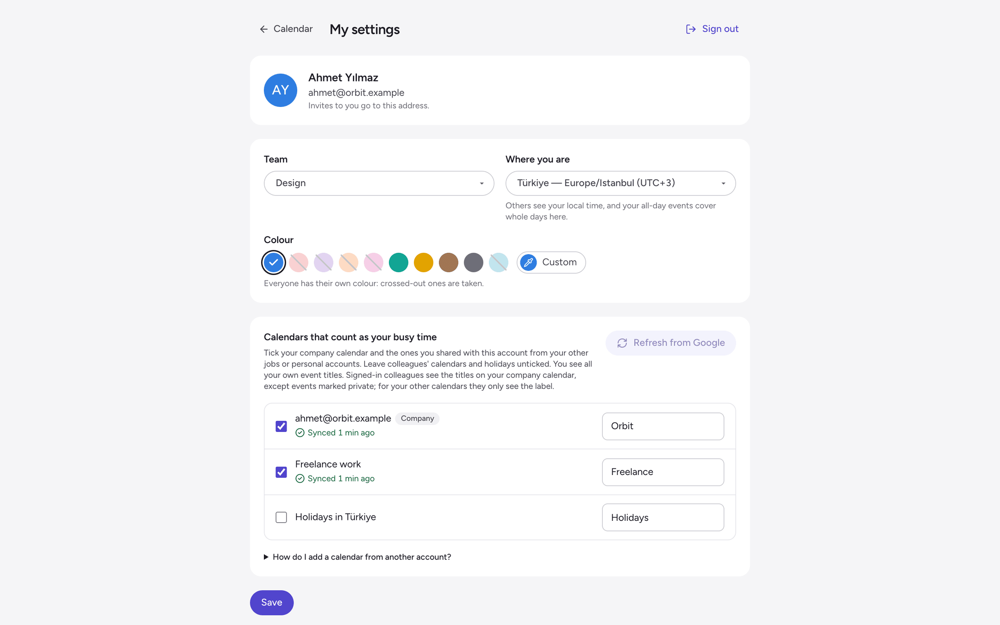
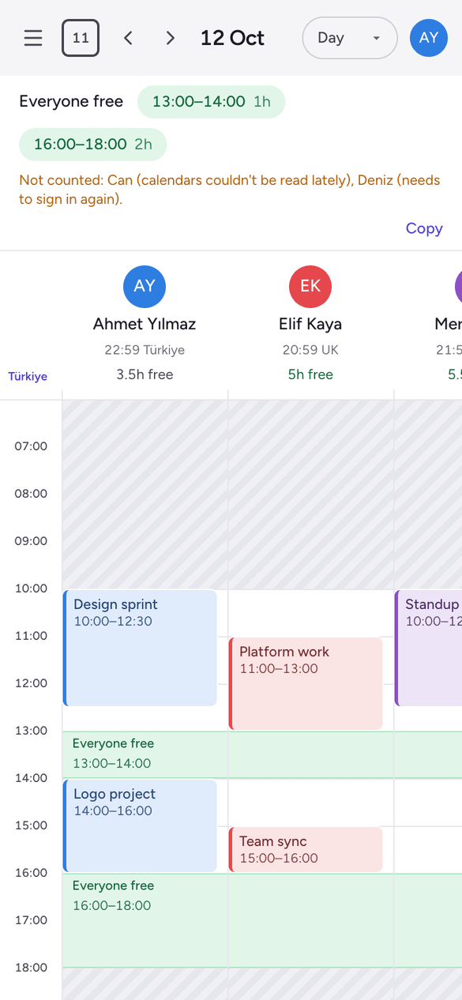

# User guide

## Adding yourself

1. **Share your other calendars with your company account.** These are your other jobs' calendars, and your personal one if you like. In Google Calendar, signed in as the account that owns the calendar:
   1. Open **Settings** and pick the calendar.
   2. Choose **Share with specific people** and add your company address.
   3. Open the email Google then sends to your company address, and press **Add this calendar**. Until you do, the calendar isn't in your company account's list. (Signed in to Google Calendar as your company account, **Other calendars → + → Subscribe to calendar** with the other account's address does the same.)

   *See only free/busy* is enough. *See all event details* also lets the app tell tentative and all-day events apart.
2. **Sign in** to Ekip Takvim with your company Google account, and allow calendar access.
3. **On My settings:**
   - Pick your team and where you are.
   - Tick the calendars that are your own time, and give each a label, like *Freelance* or *Café*. Your company calendar is ticked already. Everyone who can open the app sees labels, so an email address is replaced with *Work* or *Personal*.
   - Leave colleagues' calendars and holiday calendars unticked.
   - Save.

   

**Sharing another calendar later?** It appears on *My settings* marked **New**, and a number shows on your avatar, after the next sync or after **Refresh from Google**. Tick it and save; until then it doesn't count.

**Leaving?** **Remove me** on *My settings* takes you off the app, deletes your data and gives the Google access back.

## The views

- **Day:** everyone side by side, one column each. Green bands mark when everyone you've ticked is free.
- **Week:** seven big day boxes. Each lists, as plain text, when every person is free, which job they're at, and the slots everyone shares.
- **Month:** each day shows each person's free hours ("6h free", "Busy", "Off") and how much time everyone has together.
- **Find a time:** every gap where everyone is free for at least the length you choose, over the next 3 to 30 days. *Almost works* lists slots that suit everyone but one person.
- **Status:** each calendar's sync state, its last good sync, errors, and who needs to sign in again. When something's wrong, a red pill shows in the header.

The people list on the left decides who every view is about. Tick people one by one, or a team's **All**.

**Pick a time range:** drag or click on the grid. A card shows who's free and who's busy, and which job they're at. **Copy as text** turns a slot or selection into a line ready for a chat message.

**Event details:** click an event whose title you can see (your own, or one on a colleague's company calendar). You get the time, also on the owner's clock, a **Join meeting** button, the place, the description and a link to Google Calendar.

**Invites:** start one from the selection card or from a row in *Find a time*. Pick the start, the length and who to invite, then open it in:
- **Google Calendar:** prefilled with every guest, in your own company account. Google offers to email the guests when you save.
- **Outlook:** prefilled with everything but the guests, whose addresses are copied for you to paste.
- **An `.ics` file:** for Apple Calendar and anything else.

## Who's counted

Someone whose calendars can't be trusted right now isn't counted as free. Their column is hatched, and the reason shows next to their name:

| Shows | Why | What fixes it |
|---|---|---|
| Needs to sign in | Their Google access ended | They sign in again |
| No recent data | Their calendars couldn't be read lately | The Status page shows the error |
| Loading… | They just signed in or ticked a calendar | Wait a minute |
| No calendars | They haven't picked any calendar yet | They tick some on *My settings* |

Shared free time and *Find a time* use the people with good data, and say who was left out.

## What counts as free

You're free when none of your ticked calendars has an event at that time.

| Event | Counts as |
|---|---|
| A normal event | Busy |
| *Show as: Free* (Google's default for all-day events) | Free |
| Cancelled, or declined by you | Free |
| Working location | Free |
| Tentative, or you replied *maybe* | Busy, drawn striped |
| An all-day event shown as busy (holiday, out of office) | Busy all day, in the all-day row |
| Anything on a calendar shared as *free/busy only* | Busy, since Google says nothing more |

## Working hours and time zones

- **Working hours:** only company working hours can be picked or searched. The rest of the day is hatched as off-hours. **Show off-hours** in the sidebar (or `o`) opens them up, when someone needs an evening or weekend slot.
- **Your zone:** every time is shown in your own zone. The sidebar has a clock for each of the team's zones, with yours marked **You**. Click another clock to see the calendar on its time.
- **Others' local time:** each person's local time shows next to their name. The selection card and the invite dialog say what a slot is on their clock, e.g. "15:00–16:00 UK for them".

## Keyboard shortcuts

| Key | Does |
|---|---|
| `t` | Today |
| `d`, `w`, `m`, `f` | Day, week, month, find a time |
| `j`, `k` | Next, previous |
| `o` | Show or hide off-hours |
| `Esc` | Clear the selection |
| `?` | Help |
