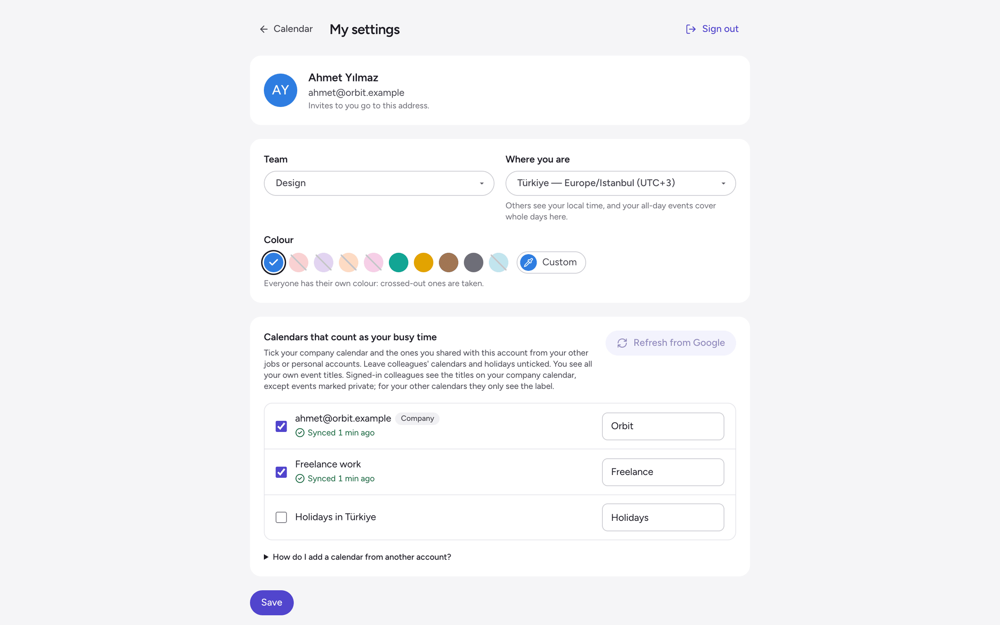
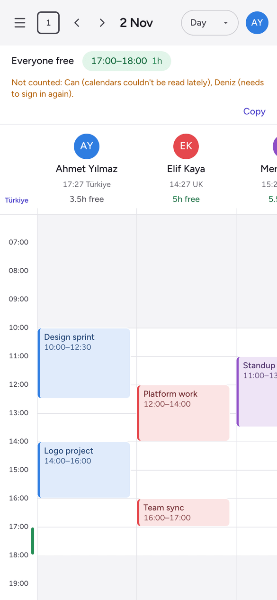

# User guide

## Adding yourself

1. **Share your other calendars with your company account.** These are your other jobs' calendars, and your personal one if you like. In Google Calendar, signed in as the account that owns the calendar:
   1. Open **Settings** and pick the calendar.
   2. Choose **Share with specific people** and add your company address.
   3. Open the email Google then sends to your company address, and press **Add this calendar**. Until you do, the calendar isn't in your company account's list. (Signed in to Google Calendar as your company account, **Other calendars → + → Subscribe to calendar** with the other account's address does the same.)

   *See only free/busy* is enough. *See all event details* also lets the app tell tentative and all-day events apart.

   A calendar that isn't on Google, such as an Outlook, iCloud, Proton or Nextcloud one, is added with its [calendar link](#calendar-links) instead.
2. **Sign in** to Ekip Takvim with your company Google account, and allow calendar access.
3. **On My settings:**
   - Pick your team and where you are.
   - Tick the calendars that are your own time, and give each a label, like *Freelance* or *Café*. Your company calendar is ticked already. Everyone who can open the app sees labels, so an email address is replaced with *Work* or *Personal*.
   - Leave colleagues' calendars and holiday calendars unticked.
   - Save.

   

**Sharing another calendar later?** It appears on *My settings* marked **New**, and a number shows on your avatar, after the next sync or after **Refresh from Google**. Tick it and save; until then it doesn't count.

**Leaving?** **Remove me** on *My settings* takes you off the app, deletes your data and gives the Google access back.

## Calendar links

A calendar that isn't on Google can count as your busy time too, through its calendar link: the secret iCal (ICS) address its service gives out so other apps can read it. You still sign in with your company Google account.

1. **Copy the link** where the calendar's service keeps it:

   | Service | Where |
   |---|---|
   | Outlook | **Publish calendar**, in Outlook's calendar settings: publish the calendar, then copy its ICS link. |
   | iCloud | **Public calendar**, in the calendar's sharing options: turn it on, then copy the link. |
   | Proton Calendar | **Share via link**, in the calendar's settings. |
   | Nextcloud | **Copy subscription link**, in the calendar's menu. |

   A link that starts with `webcal://` works as it is. A Google calendar of another account is better shared with your company account, as [above](#adding-yourself).
2. **On My settings**, under your calendars, paste it into **Add a calendar link**, give it a label, and press **Add**. The app reads the calendar straight away. A link that doesn't work is turned down with the reason ([what each one means](troubleshooting.md#calendar-links)); one that works is listed with your calendars under its host name, ticked.

From then on it's read again about every 10 minutes, and its tick and label work like your Google calendars': untick it and save, and it stops counting. You can add up to 10.

**The link is a secret.** Anyone who has it can read the calendar, often with every event's details. Only the server keeps it, encrypted: the app shows nobody the link, not even you, only its host, and colleagues only ever see the label. Don't paste it anywhere else. If it gets out, reset it in the calendar's service (stop publishing or sharing, then start again), then remove the calendar here and add the new link.

**Removing one:** press **Remove** next to it, then **Yes, remove**. Its events leave the app straight away. To stop the link working at all, also stop publishing or sharing the calendar in its service.

Changes to the calendar show up within about 10 minutes, once its service has updated the file it serves, which can take a while on some services. To read your links sooner, press **Refresh from Google** on *My settings*.

## Booking links

A booking link lets anyone book a time with you, whether they're on the team or not: a client, a candidate, a supplier. It works like Google Calendar's appointment schedules, with [a few differences](#how-booking-links-differ-from-googles-appointment-schedules). Booking links are there when the server has them turned on (`BOOKING_LINKS=on`, see [configuration](configuration.md#environment-variables)). They're on *My settings*, under **Booking links**. To get there from the calendar, sign in and press **Booking links** under **Find a time** (on a phone, in the ☰ menu); *How it works* mentions them too.

**Allow access first:** each booked meeting goes into your Google Calendar, so your links offer times only once you've allowed that. Under **Booking links** on *My settings*, a note says so: press **Allow access**, and on Google's screen tick *View and edit events on all your calendars*. The app uses it only to add the meetings booked with you to your primary calendar, and to delete them when a booking is cancelled; nothing else in your calendar changes. Google then sends you back to **Booking links**, with a note shown once:
- *Done: your booking links can take bookings.*: it worked, and the note above your links is gone.
- *Google didn't give the permission. Press Allow access again and tick View and edit events on all your calendars.*: the box was left unticked. Do as it says.
- *Access wasn't allowed. Nothing changed.*: you cancelled on Google's screen.

You can make and edit links before you allow it. If you untick it on Google's screen, or later remove the app in your Google account, the note above your links comes back. In the demo, everyone has allowed it already.

**Making one:** on *My settings*, under **Booking links**, press **New booking link**, fill it in and press **Create link**. Enter doesn't create it; only the button does. Where the form was, a line then says the link is ready, such as *Link ready: Intro call · Copy · Open*: **Copy** copies its address to send, and **Open** opens its page. It stays until you do something else in the section.

| Field | What it does | Starts at |
|---|---|---|
| Title, Description | What visitors see at the top of the page. | |
| Length | 15, 30 or 45 minutes, 1 hour, 1 h 30 min or 2 hours. | 30 min |
| Hours, Days | When times can be: these hours, on these weekdays, on your clock (the zone on *My settings*). | The company's working hours, Monday to Friday |
| Break between meetings | Kept free before and after each time, away from your events and other bookings. | None |
| Minimum notice | How long before a time it can still be booked. | 4 hours |
| Days ahead, today included | How far ahead times are offered, up to the days the app reads (`horizon_days`). | 14 |
| Bookings per day | At most this many bookings on the link a day. | No limit |
| Add a Google Meet link | The meeting's event in your Google Calendar gets a Google Meet link, which the visitor's invitation shows. | Off |

Each link is listed with its length, days and hours, *Meet* when it adds a Google Meet link, and its address, which you can select and copy yourself. **Copy link** copies that address to send, and **Open** opens the link's page in a new tab, as visitors see it. The switch turns it off and on again: while it's off, visitors can't book it (its page says the link doesn't exist), it has no **Open**, and **Copy link** reminds you to turn it on before you send it. **Edit** changes it, and **Delete**, then **Yes, delete**, removes it for good. Bookings made on a deleted link stay, and you can still cancel them. You can have up to 10 links.

**What visitors see and do:**

1. They open the link and see your name, the title, the length and the description, and *Google Meet video call* when the link adds a Meet link. Below are the free times, grouped by day, on their own clock: in their time zone, which the page names with its offset, such as *Istanbul time (GMT+3)*, and in their browser's 12- or 24-hour format (*4:00 pm* or *16:00*).
2. A time is offered when it's within the link's hours and days, nothing on your counted calendars and none of your bookings on any link is within the break around it, it isn't sooner than the minimum notice, and the day hasn't reached its bookings-per-day limit. A day the link offers whose times are all taken, by that limit or because you're busy, is listed as *Fully booked*; the page doesn't say which. The link offers no times while your calendars can't be trusted (anything but OK under [who's counted](#whos-counted)), before you **Allow access**, and once it took 30 bookings in the last hour, until the oldest of them is an hour old. Then the page only says there are no free times, and lists no days.
3. They pick a time, give their name, email address and, if they like, a note, and press **Book**. If someone else booked that time first, or Google says you're busy then, they're told the time was just taken and the times refresh. After 5 tries in 10 minutes from one address, **Book** waits, and the page says for how many minutes.
4. They see what they booked, that an invitation is on its way to their email address and, with a Meet link, that the link comes with it. The page's address is now the booking's cancel link, so they keep it or bookmark the page. Opening it again shows the booking, *You're booked*, with **Cancel booking**, until the meeting ends; after that, it says the meeting took place. Once the booking is cancelled or over, the page offers **Book another time** while the link is on.

**What a booking makes:** an event on your primary Google calendar, which Google sends the visitor an invitation for.
- Its title is the link's title with the visitor's name, such as *Intro call (Ayşe Kaya)*.
- Its description is the link's description, the visitor's note, and *Booked through Ekip Takvim.* The cancel link isn't in it: colleagues who can see your event details would see it too.
- The visitor is its only guest. With **Add a Google Meet link**, it has a Meet link.
- Just before making it, the app asks Google whether you're still free then, so an event you added since the last sync is seen.

The event syncs back like your other events: colleagues see it as they see any event on your company calendar ([who sees what](privacy-and-security.md#who-sees-what)). If Google can't be reached, or refuses, the visitor is told the link can't take bookings right now, and nothing is booked. In the demo, nothing goes to Google: the booking is made straight away, and no one is invited.

**Upcoming bookings**, on *My settings*, lists each booking's time, the visitor's name, email address and note, until it's over. A booking keeps its time from being booked again on all your links.

**Cancelling:** the visitor opens their cancel link and presses **Cancel booking**. Or you press **Cancel** next to the booking, then **Yes, cancel it**. Either way the event is deleted from your Google Calendar, Google tells the visitor, and its time can be booked again. If Google can't delete it right then, the booking stays, with *Couldn't cancel right now*: try again in a few minutes. Once its meeting has ended, a booking can't be cancelled any more, by either of you: it took place, and its event stays in your Google Calendar.

**Deleting the event in Google Calendar** cancels the booking too: its time can be booked again after the next sync. That needs your primary calendar to count (ticked under *Calendars that count as your busy time*); if it doesn't, cancel the booking here instead.

**Moving the event in Google Calendar** doesn't move the booking: Ekip Takvim keeps holding its original time. To change a time, cancel the booking and send the visitor your link to book again.

**A visitor who lost the cancel link**, the confirmation page's address, can decline the invitation. That doesn't cancel the booking: you cancel it under **Upcoming bookings**, or delete the event in Google Calendar.

### How booking links differ from Google's appointment schedules

Booking links cover the common case. Where they differ from Google Calendar's appointment schedules:

- **Several links:** up to 10 per person, each with its own length and rules. Google's free plan has one booking page.
- **Every counted calendar:** a link avoids everything on the calendars that count as your busy time, other jobs' calendars and calendar links included. Google's free plan checks only the schedule's own calendar.
- **One range of hours** for all of a link's days, and no exceptions for single dates, such as a holiday: turn the link off, or put an event in your calendar.
- **Google Meet or nothing:** there's no in-person or phone option, so put the place or the number in the description.
- **No questions** beyond the visitor's name, email address and an optional note.
- **A list of times**, grouped by day, rather than a month calendar.
- **Cancelling:** the visitor cancels on the confirmation page's address, the cancel link, which the invitation doesn't carry. Declining the invitation doesn't cancel. You cancel on *My settings*, or by deleting the event.
- **No notices to you:** the app doesn't tell you about a booking or a cancellation. The event just appears in your calendar, or leaves it.
- **Moving the event** in Google Calendar doesn't move the booking.
- **No reminders, payments or email checks**, which Google has on paid plans.
- **On a phone too:** you make and change links on *My settings*, on any device. Google's apps can only share a booking page; making or changing one needs a computer.

## The views

- **Day:** everyone side by side, one column each. Free time stays empty. A green mark beside the hours, and the chips above the grid, show when everyone you've ticked is free.
- **Week:** seven big day boxes. Each lists, as plain text, when every person is free, which job they're at, and the slots everyone shares.
- **Month:** each day shows each person's free hours ("6h free", "Busy", "Off") and how much time everyone has together.
- **Find a time:** every gap where everyone is free for at least the length you choose, over the next 3 to 30 days. *Almost works* lists slots that suit everyone but one person. To settle for fewer, pick **At least N of M**: it lists the times when at least N people are free, and who would miss each one. For a meeting that repeats, set **Repeat** to **Every week** for 4, 6 or 8 weeks: it lists, for each weekday, the times that suit the same people every week. Its invites repeat in Google Calendar; Outlook and the `.ics` file add the first meeting only.
- **Status:** each calendar's sync state, its last good sync, errors, and who needs to sign in again. When something's wrong, a red pill shows in the header.

The people list on the left decides who every view is about. Tick people one by one, or a team's **All**.

**Pick a time range:** drag or click on the grid. A card shows who's free and who's busy, and which job they're at. **Copy as text** turns a slot or selection into a line ready for a chat message.

**Event details:** click an event whose title you can see (your own, or one on a colleague's company calendar). You get the time, also on the owner's clock, a **Join meeting** button, the place, the description and a link to Google Calendar.

**Invites:** start one from the selection card or from a row in *Find a time*. Pick the start, the length and who to invite, then open it in:
- **Google Calendar:** prefilled with every guest, in your own company account. Google offers to email the guests when you save.
- **Outlook:** prefilled with everything but the guests, whose addresses are copied for you to paste.
- **An `.ics` file:** for Apple Calendar and anything else.

## Who's counted

Someone whose calendars can't be trusted right now isn't counted as free. Their column is hatched, and the reason shows next to their name:

| Shows | Why | What fixes it |
|---|---|---|
| Needs to sign in | Their Google access ended | They sign in again |
| No recent data | Their calendars couldn't be read lately | The Status page shows the error |
| Loading… | They just signed in or ticked a calendar | Wait a minute |
| No calendars | They haven't picked any calendar yet | They tick some on *My settings* |

Shared free time and *Find a time* use the people with good data, and say who was left out.

## What counts as free

You're free when none of your ticked calendars has an event at that time.

| Event | Counts as |
|---|---|
| A normal event | Busy |
| *Show as: Free* (Google's default for all-day events) | Free |
| Cancelled, or declined by you | Free |
| Working location | Free |
| Tentative, or you replied *maybe* | Busy, drawn striped |
| An all-day event shown as busy (holiday, out of office) | Busy all day, in the all-day row |
| Anything on a calendar shared as *free/busy only* | Busy, since Google says nothing more |

A calendar link's events follow the same rules as far as the calendar's file tells: cancelled ones and ones shown as free don't count, and tentative ones are striped. An invitation you declined still counts as busy if the file lists it. [Known limits](troubleshooting.md#calendar-links).

## Working hours and time zones

- **Working hours:** only company working hours can be picked or searched. The rest of the day is shaded grey as off-hours. **Show off-hours** in the sidebar (or `o`) opens them up, when someone needs an evening or weekend slot.
- **Your zone:** every time is shown in your own zone. The sidebar has a clock for each of the team's zones, with yours marked **You**. Click another clock to see the calendar on its time.
- **Others' local time:** each person's local time shows next to their name. The selection card and the invite dialog say what a slot is on their clock, e.g. "15:00–16:00 UK for them".

## Keyboard shortcuts

| Key | Does |
|---|---|
| `t` | Today |
| `d`, `w`, `m`, `f` | Day, week, month, find a time |
| `j`, `k` | Next, previous |
| `o` | Show or hide off-hours |
| `Esc` | Clear the selection |
| `?` | Help |
